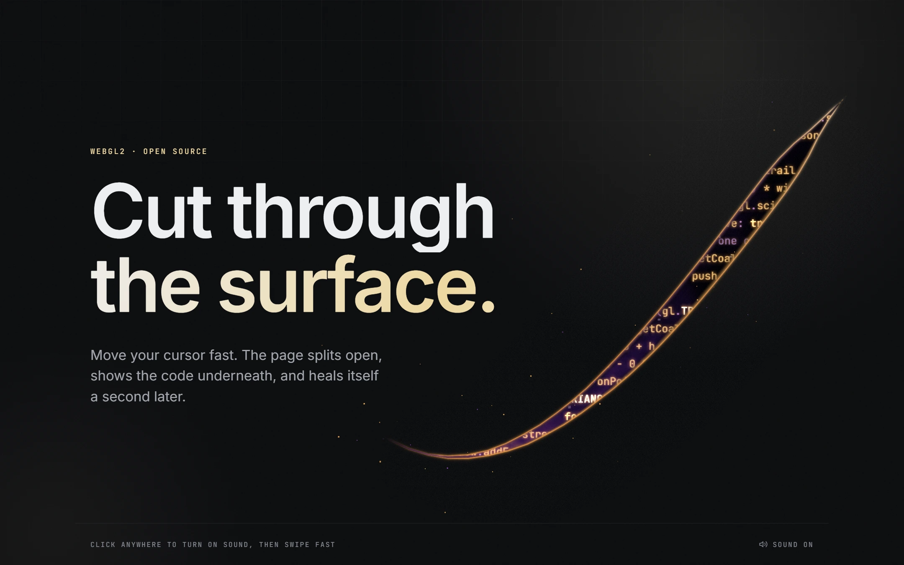
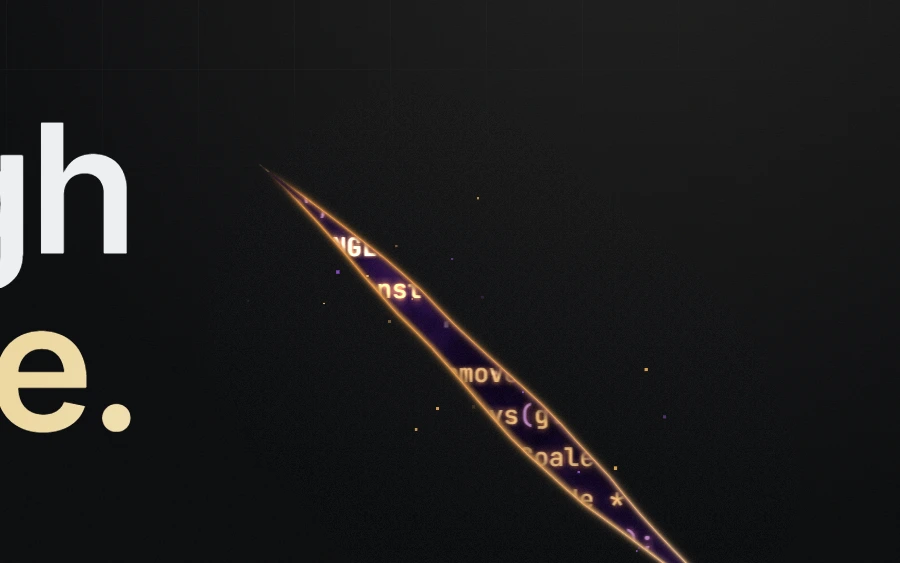
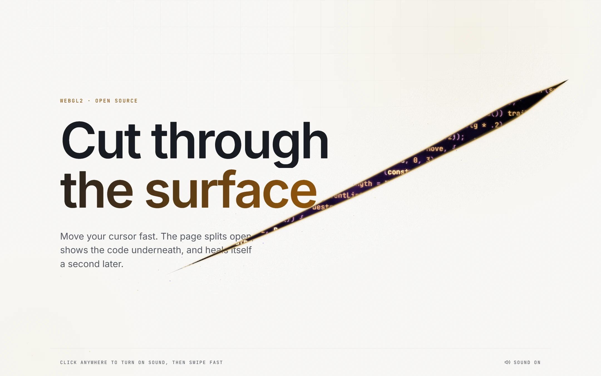

# Cursor Cut Reality

A WebGL2 hero banner you can slice open with your cursor.

Move the mouse fast and the page splits along the blade's path. The grid around the cut bends away from it, code glows inside it over deep space, and the cut heals about a second later. Slow movement does nothing, so the page stays calm while people read it.

Inspired by the reality-tearing rifts in *Doctor Strange in the Multiverse of Madness*.



<!-- Drop a screen recording here: on GitHub, edit this file and drag an .mp4 into the editor. -->

| Inside the cut | Light theme |
| --- | --- |
|  |  |

## Try it

```bash
npm install
npm run dev
```

Open the printed URL on a computer with a mouse or trackpad, and swipe fast across the page. Add `?theme=light` to the URL for the light theme.

Requires Node 20.19 or newer.

## Use it in your own project

The effect lives in [`src/hero-rift/`](src/hero-rift). It has no dependencies. Copy that folder into your project, then:

```ts
import { createHeroRift } from "./hero-rift";
import "./hero-rift/hero-rift.css";

const rift = createHeroRift(document.querySelector("#hero")!, {
  sound: "/sounds/rift.wav", // optional
});

// later, if the hero is removed:
rift.destroy();
```

`createHeroRift` adds three layers behind the section's content (the grid, the light, and the WebGL canvas) and makes the section `position: relative; isolation: isolate`. Your content stays on top and stays clickable; the canvas never takes pointer events.

### React / Next.js

```tsx
"use client";

import { useEffect, useRef } from "react";
import { createHeroRift } from "@/hero-rift";
import "@/hero-rift/hero-rift.css";

export default function Hero() {
  const ref = useRef<HTMLElement>(null);

  useEffect(() => {
    const rift = createHeroRift(ref.current!, { sound: "/sounds/rift.wav" });
    return () => rift.destroy();
  }, []);

  return (
    <section ref={ref} style={{ minHeight: "100svh" }}>
      {/* your hero content */}
    </section>
  );
}
```

### Options

| Option | Default | |
| --- | --- | --- |
| `code` | a few lines of the rift's own source | The text that shows through the cut. Use your own code. |
| `sound` | none | URL of a short whoosh or hit. Leave it out for a silent rift. |
| `soundEnabled` | `true` | Start with the sound on or off. |

The returned object has `setSoundEnabled(on)`, `destroy()`, and `active` (false when the effect isn't running on this device).

### Colours

Set these on the section (or any parent). Values are space-separated HSL:

```css
#hero {
  --rift-bg: 220 13% 5%;          /* page background */
  --rift-fg: 220 12% 94%;         /* grid lines */
  --rift-accent: 43 58% 85%;      /* warm light in the corners */
  --rift-accent-strong: 45 74% 91%; /* the cut's edge on a light background */
  --rift-font-mono: "JetBrains Mono"; /* font of the code in the cut */
}
```

A light theme is included: put `data-theme="light"` on the hero or on `<html>`. Light or dark is worked out from `--rift-bg`, and the effect updates when the theme changes.

The shader redraws the grid and the light layers inside the bent area around the cut. If you change their CSS in `hero-rift.css`, change `surface()` in `shaders.ts` to match, or the edge of the bent area will show.

## Sound

Browsers only allow audio after a click or key press, so the sound starts working after the visitor's first click anywhere on the page.

The demo plays [`public/sounds/rift.wav`](public/sounds/rift.wav): "Conjunctioning squeal item" from [Mixkit](https://mixkit.co/free-sound-effects/). To use another sound, replace that file or pass a different URL as `sound`. Any short whoosh or hit works: silence at the start and end of the file is trimmed automatically when it loads.

## Where it runs

- **Desktop with a mouse or trackpad:** the full effect.
- **Phones and tablets, and visitors who ask for reduced motion:** the static grid only. The WebGL code is never downloaded.
- **No WebGL2:** the static grid only.

## Performance

- The WebGL code is a separate ~12 KB (gzipped) file, loaded when the browser is idle after the page has painted.
- Nothing renders while the page is still. The loop starts on a fast swipe and stops when the cut has healed.
- Only the area around the cut is drawn (scissor box), and the nebula behind the code is baked into a texture once.
- Resolution is capped at 1.5× and drops automatically if frames run slow.
- The loop pauses when the hero is scrolled out of view or the tab is hidden, and the WebGL context recovers if the GPU resets.

## License

The code is [MIT](LICENSE).

The sound (`public/sounds/rift.wav`) is not covered by the MIT license. It is "Conjunctioning squeal item" (#3147) from [Mixkit](https://mixkit.co/), used under the [Mixkit Sound Effects Free License](https://mixkit.co/license/).
